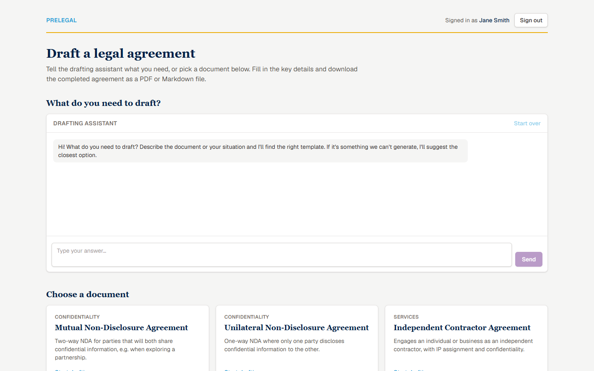
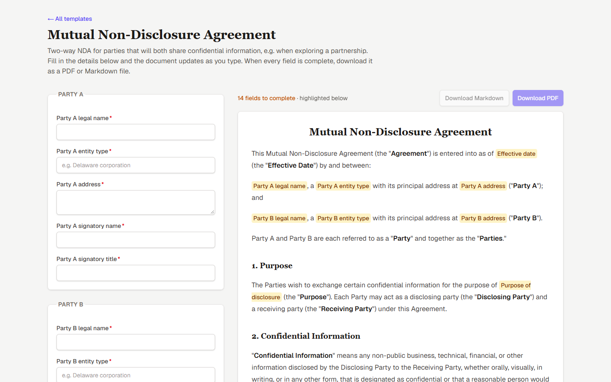
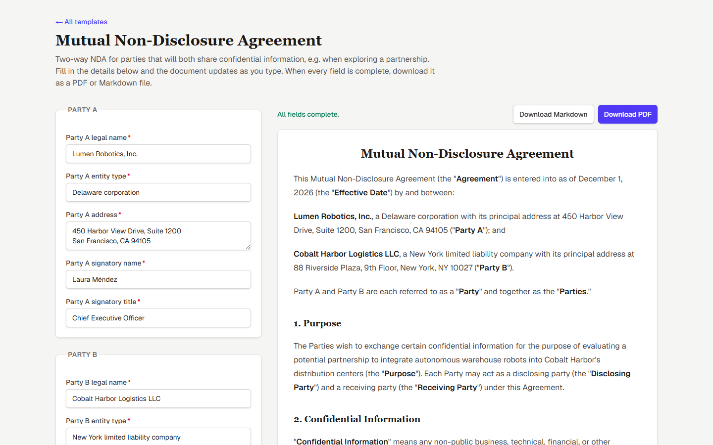
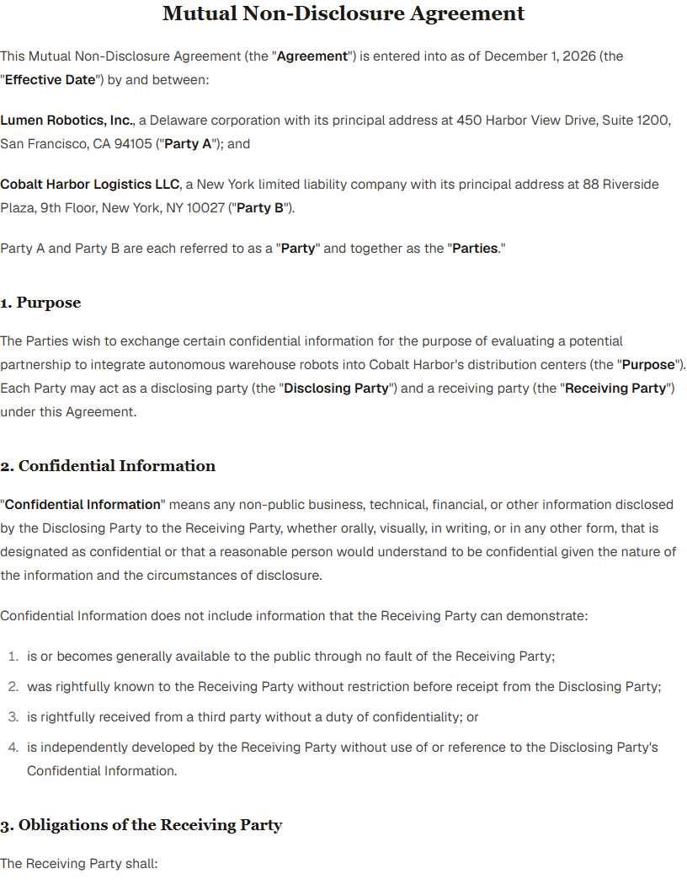

# PreLegal
A platform for drafting common legal agreements

**🌐 Live site: <https://prelegal-blue.vercel.app>**

PreLegal is a generic document creator: pick any template, fill it in, watch the agreement update live, and download the completed document as PDF or Markdown. Tell the **AI drafting assistant** what you need: it picks the right document (or explains it can't generate it and offers the closest one), then fills it in as you answer. The form is still there as a fallback. The forms and documents come straight from the template dataset in [`data/templates`](data/templates), so adding a template to the catalog adds it to the site.

> 🚧 **Status: In progress.** This project is under active development and is expected to be completed within 1 week (target: November 28, 2026).

## What you can draft

| Document | Category | Description |
| --- | --- | --- |
| [Mutual Non-Disclosure Agreement](https://prelegal-blue.vercel.app/templates/mutual-nda) | confidentiality | Two-way NDA for parties that will both share confidential information, e.g. when exploring a partnership. |
| [Unilateral Non-Disclosure Agreement](https://prelegal-blue.vercel.app/templates/unilateral-nda) | confidentiality | One-way NDA where only one party discloses confidential information to the other. |
| [Independent Contractor Agreement](https://prelegal-blue.vercel.app/templates/independent-contractor-agreement) | services | Engages an individual or business as an independent contractor, with IP assignment and confidentiality. |
| [Consulting Services Agreement](https://prelegal-blue.vercel.app/templates/consulting-services-agreement) | services | Hourly consulting engagement with defined scope, deliverables, fee cap, and limitation of liability. |
| [Employment Offer Letter](https://prelegal-blue.vercel.app/templates/employment-offer-letter) | employment | At-will employment offer covering position, start date, salary, and benefits. |
| [Intellectual Property Assignment Agreement](https://prelegal-blue.vercel.app/templates/ip-assignment-agreement) | intellectual property | Transfers ownership of specified intellectual property from an assignor to an assignee. |
| [Promissory Note](https://prelegal-blue.vercel.app/templates/promissory-note) | finance | Borrower's written promise to repay a loan with fixed interest on a defined schedule. |
| [General Release of Claims](https://prelegal-blue.vercel.app/templates/general-release) | disputes | Settles a dispute by releasing claims in exchange for a payment. |

> ⚠️ The templates are general-purpose starting points, **not legal advice**. Have a qualified attorney review a document before real use.

## Screenshots

Captured on November 23–24, 2026, so the frontend stays documented even if the deployment goes offline. All names, companies and addresses are fictional. The home page shows the AI chat (PL-8, running with the backend); the other screenshots were taken from the static Vercel site, where there is no backend, so they show the form that the chat replaces when a backend is available.

**Home: ask the drafting assistant, or pick any template in the catalog**



**Empty form: fields still to complete are highlighted in the live preview, and downloads stay disabled**



**Filled form: the agreement updates as you type**



**Any template works the same way, e.g. a Promissory Note**


| Mobile | PDF output (print view) |
| --- | --- |
|  |  |

Sample output: [`sample-mutual-nda.pdf`](docs/screenshots/sample-mutual-nda.pdf), the completed Mutual NDA from the screenshots above, as produced by **Download PDF**.

## Run locally with Docker

The whole app (frontend + backend + temporary database) runs in one Docker container at **<http://localhost:8000>**. Requires [Docker](https://www.docker.com/) to be running.

| OS | Start | Stop |
| --- | --- | --- |
| macOS | `scripts/start-mac.sh` | `scripts/stop-mac.sh` |
| Linux | `scripts/start-linux.sh` | `scripts/stop-linux.sh` |
| Windows (PowerShell) | `scripts\start-windows.ps1` | `scripts\stop-windows.ps1` |

The start script builds the image, (re)starts the `prelegal` container and waits until it is healthy. On macOS/Linux run the scripts with `bash scripts/start-mac.sh` if they are not executable. If port 8000 is taken, set `PRELEGAL_PORT` (e.g. `PRELEGAL_PORT=8001 scripts/start-linux.sh`, or `$env:PRELEGAL_PORT = 8001` in PowerShell).

- **Sign-in** is a placeholder for now (PL-6): enter any name and email, no password. Real accounts arrive with PL-9.
- **The database is temporary**: SQLite inside the container, recreated from scratch every time the container starts.
- A `.env` file in the repository root, if present, is passed to the container at run time (it is never copied into the image). The AI chat needs `OPENAI_API_KEY` there; `OPENAI_MODEL` is optional (default `gpt-4.1-mini`). Without a key the app still runs: the chat reports it isn't configured, and offers the form on a document page (on the home page, the list of documents below it).
- **AI chat (every template)**: on the home page, describe what you need and the assistant picks the document. If you ask for something PreLegal can't generate (e.g. a lease), it says so and offers the closest document, or lists what it can draft. It then opens the document's page with the conversation so far and keeps asking for what's missing. Mid-conversation you can ask for a different document: once you confirm, it switches and carries over the details that still apply (dates, governing law…). The backend calls OpenAI through LiteLLM with Structured Outputs; every value the AI extracts is validated on the server before it reaches the document. If the backend isn't reachable (e.g. the static Vercel site), the page falls back to the form. `/api/chat` has no authentication or rate limit yet (fake sign-in until PL-9), so anyone who can reach the server can spend OpenAI credits.

### Architecture

```
Docker image
├── build stage (node:24)    frontend/ + data/  ──npm run build──▶  static export (out/)
└── runtime (python:3.13)    FastAPI (backend/) on :8000, data/templates (chat prompt + schema)
                               ├── /api/*   JSON API, SQLite at /tmp/prelegal.db, AI chat ──LiteLLM──▶ OpenAI
                               └── /*       the static export (404.html for unknown pages)
```

| Endpoint | Purpose |
| --- | --- |
| `GET /api/health` | Health check |
| `POST /api/session` | Fake sign-in: records `{name, email}` in the `users` table and returns the user |
| `POST /api/chat` | One AI chat turn: `{template_id?, messages, values}` → `{reply, template_id, values, complete}`. Without `template_id` the AI picks the document; a response `template_id` that differs from the request's means the AI chose or switched documents. Errors return `{"detail": {"code", "message", "retryable"}}` |
| `GET /api/docs` | Interactive API docs |

### Development

```sh
# Backend (http://localhost:8000): API only unless PRELEGAL_STATIC_DIR points at a frontend build
cd backend
uv sync
uv run pytest                     # tests, no network (includes serving frontend/out if it has been built)
uv run ruff check . && uv run ruff format --check .
PRELEGAL_STATIC_DIR=../frontend/out uv run --env-file ../.env uvicorn app.main:create_app --factory --reload

# Frontend (see frontend/README.md)
cd frontend
npm install
npm run dev                       # http://localhost:3000, no backend: device-only sign-in, form instead of chat
npm test && npm run lint && npm run build
```

### Configuration

| Variable | Default | Purpose |
| --- | --- | --- |
| `OPENAI_API_KEY` | none | OpenAI key for the AI chat (root `.env`; read by LiteLLM, never logged or sent to the browser) |
| `OPENAI_MODEL` | `gpt-4.1-mini` | OpenAI model, called as `openai/<model>` |
| `PRELEGAL_PORT` | `8000` | Host port used by the start scripts |
| `PRELEGAL_DB_PATH` | `prelegal.db` (`/tmp/prelegal.db` in the image) | Temporary SQLite database |
| `PRELEGAL_STATIC_DIR` | unset (`/app/static` in the image) | Frontend export served at `/`; unset serves the API only |
| `PRELEGAL_TEMPLATES_DIR` | repo `data/templates` (`/app/data/templates` in the image) | Template catalog the chat builds its prompt and schema from |
| `PRELEGAL_LLM_TIMEOUT_S` / `PRELEGAL_LLM_MAX_RETRIES` | `20` / `1` | Per-attempt timeout and retries for OpenAI calls |
| `PRELEGAL_CHAT_BUDGET_S` | `50` | Total time for one chat request, which may make two OpenAI calls (choosing a document, then its first turn). Must stay below the frontend's 60 s timeout (enforced) |
| `LITELLM_LOCAL_MODEL_COST_MAP` | `True` | Use LiteLLM's bundled model map instead of fetching it at startup |

The Docker image is about 1.1 GB, mostly LiteLLM and its dependencies.

## Project structure

| Path | Description |
| --- | --- |
| [`backend`](backend) | FastAPI app (uv project): the API, the temporary SQLite database, and serving the frontend build |
| [`docs/screenshots`](docs/screenshots) | Screenshots of the app and a sample PDF |
| [`data/templates`](data/templates) | Dataset of legal document templates and their field catalog |
| [`frontend`](frontend) | Next.js app (static export): sign-in, the AI chat (home page and every template) with the form as fallback. See [frontend/README.md](frontend/README.md) |
| [`scripts`](scripts) | Start/stop scripts for macOS, Linux and Windows, and `validate-templates.mjs` |
| [`Dockerfile`](Dockerfile) | Multi-stage build of the whole app |

## Deployment

The frontend is deployed on [Vercel](https://vercel.com) as the project **`prelegal`**: <https://prelegal-blue.vercel.app>

Project settings (already configured):

| Setting | Value | Why |
| --- | --- | --- |
| Root Directory | `frontend` | The Next.js app lives there |
| Include source files outside of the Root Directory | Enabled | The app reads `data/templates` at build time |
| Framework Preset | Next.js | |
| Node.js Version | 24.x | Next.js 16 and Vitest 5 need Node 22+ |

To deploy from a local checkout (run from the **repository root**, not `frontend/`, so `data/templates` is uploaded too):

```sh
npx vercel login                       # once
npx vercel link --yes --project prelegal  # once; writes .vercel/ (git-ignored)
npx vercel deploy                      # preview deployment
npx vercel deploy --prod               # production deployment
```

The frontend is a static export (`output: "export"`), so the Vercel deployment is fully static and has **no backend**: sign-in still works there but is kept on the visitor's device only. Run the app with Docker (above) for the full stack.

> **Automatic deploys from GitHub** are not connected yet. To enable them, add GitHub as a login connection in Vercel (Account Settings → Authentication), then run `npx vercel git connect --project prelegal` and `npx vercel project update prelegal --git-branch main`. After that, pushes to `main` deploy to production and pull requests get preview URLs.
