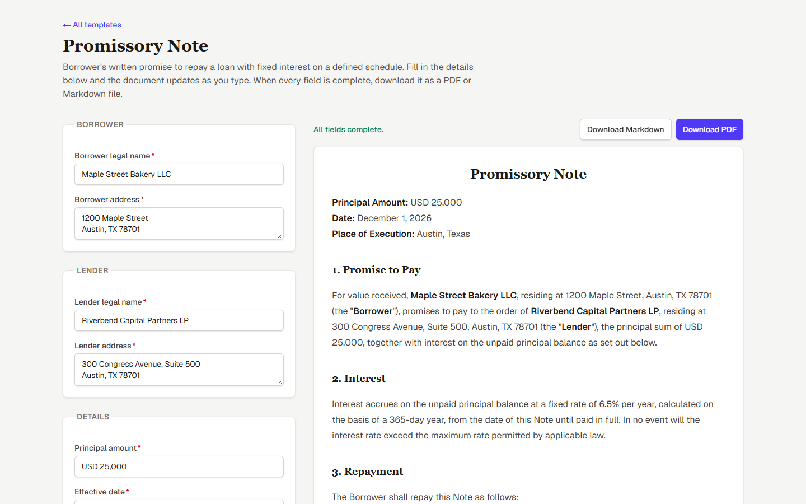
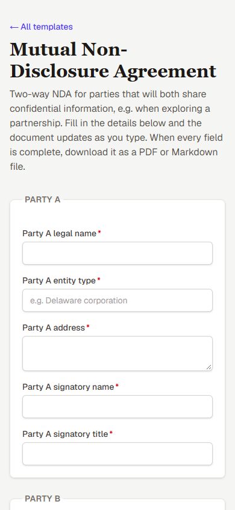

# PreLegal
A platform for drafting common legal agreements

**🌐 Live site: <https://prelegal-blue.vercel.app>**

PreLegal is a generic document creator: pick any template, fill in a form, watch the agreement update live as you type, and download the completed document as PDF or Markdown. The forms and documents come straight from the template dataset in [`data/templates`](data/templates), so adding a template to the catalog adds it to the site.

> 🚧 **Status: In progress.** This project is under active development and is expected to be completed within 1 week (target: November 28, 2026).

## What you can draft

| Document | Category | Description |
| --- | --- | --- |
| [Mutual Non-Disclosure Agreement](https://prelegal-blue.vercel.app/templates/mutual-nda) | confidentiality | Two-way NDA for parties that will both share confidential information, e.g. when exploring a partnership. |
| [Unilateral Non-Disclosure Agreement](https://prelegal-blue.vercel.app/templates/unilateral-nda) | confidentiality | One-way NDA where only one party discloses confidential information to the other. |
| [Independent Contractor Agreement](https://prelegal-blue.vercel.app/templates/independent-contractor-agreement) | services | Engages an individual or business as an independent contractor, with IP assignment and confidentiality. |
| [Consulting Services Agreement](https://prelegal-blue.vercel.app/templates/consulting-services-agreement) | services | Hourly consulting engagement with defined scope, deliverables, fee cap, and limitation of liability. |
| [Employment Offer Letter](https://prelegal-blue.vercel.app/templates/employment-offer-letter) | employment | At-will employment offer covering position, start date, salary, and benefits. |
| [Intellectual Property Assignment Agreement](https://prelegal-blue.vercel.app/templates/ip-assignment-agreement) | intellectual property | Transfers ownership of specified intellectual property from an assignor to an assignee. |
| [Promissory Note](https://prelegal-blue.vercel.app/templates/promissory-note) | finance | Borrower's written promise to repay a loan with fixed interest on a defined schedule. |
| [General Release of Claims](https://prelegal-blue.vercel.app/templates/general-release) | disputes | Settles a dispute by releasing claims in exchange for a payment. |

> ⚠️ The templates are general-purpose starting points, **not legal advice**. Have a qualified attorney review a document before real use.

## Screenshots

Captured from the live site (<https://prelegal-blue.vercel.app>) on November 23, 2026, so the frontend stays documented even if the deployment goes offline. All names, companies and addresses are fictional.

**Home: every template in the catalog**


**Empty form: fields still to complete are highlighted in the live preview, and downloads stay disabled**


**Filled form: the agreement updates as you type**


**Any template works the same way, e.g. a Promissory Note**



| Mobile | PDF output (print view) |
| --- | --- |
|  |  |

Sample output: [`sample-mutual-nda.pdf`](docs/screenshots/sample-mutual-nda.pdf), the completed Mutual NDA from the screenshots above, as produced by **Download PDF**.

## Run locally with Docker

The whole app (frontend + backend + temporary database) runs in one Docker container at **<http://localhost:8000>**. Requires [Docker](https://www.docker.com/) to be running.

| OS | Start | Stop |
| --- | --- | --- |
| macOS | `scripts/start-mac.sh` | `scripts/stop-mac.sh` |
| Linux | `scripts/start-linux.sh` | `scripts/stop-linux.sh` |
| Windows (PowerShell) | `scripts\start-windows.ps1` | `scripts\stop-windows.ps1` |

The start script builds the image, (re)starts the `prelegal` container and waits until it is healthy. On macOS/Linux run the scripts with `bash scripts/start-mac.sh` if they are not executable. If port 8000 is taken, set `PRELEGAL_PORT` (e.g. `PRELEGAL_PORT=8001 scripts/start-linux.sh`, or `$env:PRELEGAL_PORT = 8001` in PowerShell).

- **Sign-in** is a placeholder for now (PL-6): enter any name and email, no password. Real accounts arrive with PL-9.
- **The database is temporary**: SQLite inside the container, recreated from scratch every time the container starts.
- A `.env` file in the repository root, if present, is passed to the container at run time (it is never copied into the image).

### Architecture

```
Docker image
├── build stage (node:24)    frontend/ + data/  ──npm run build──▶  static export (out/)
└── runtime (python:3.13)    FastAPI (backend/) on :8000
                               ├── /api/*   JSON API, SQLite at /tmp/prelegal.db
                               └── /*       the static export (404.html for unknown pages)
```

| Endpoint | Purpose |
| --- | --- |
| `GET /api/health` | Health check |
| `POST /api/session` | Fake sign-in: records `{name, email}` in the `users` table and returns the user |
| `GET /api/docs` | Interactive API docs |

### Development

```sh
# Backend (http://localhost:8000): API only unless PRELEGAL_STATIC_DIR points at a frontend build
cd backend
uv sync
uv run pytest                     # tests (includes serving frontend/out if it has been built)
uv run ruff check . && uv run ruff format --check .
PRELEGAL_STATIC_DIR=../frontend/out uv run uvicorn app.main:create_app --factory --reload

# Frontend (see frontend/README.md)
cd frontend
npm install
npm run dev                       # http://localhost:3000, sign-in is device-only without the backend
npm test && npm run lint && npm run build
```

## Project structure

| Path | Description |
| --- | --- |
| [`backend`](backend) | FastAPI app (uv project): the API, the temporary SQLite database, and serving the frontend build |
| [`docs/screenshots`](docs/screenshots) | Screenshots of the live site and a sample PDF |
| [`data/templates`](data/templates) | Dataset of legal document templates and their field catalog |
| [`frontend`](frontend) | Next.js app (static export): sign-in and the document creator for every catalog template. See [frontend/README.md](frontend/README.md) |
| [`scripts`](scripts) | Start/stop scripts for macOS, Linux and Windows, and `validate-templates.mjs` |
| [`Dockerfile`](Dockerfile) | Multi-stage build of the whole app |

## Deployment

The frontend is deployed on [Vercel](https://vercel.com) as the project **`prelegal`**: <https://prelegal-blue.vercel.app>

Project settings (already configured):

| Setting | Value | Why |
| --- | --- | --- |
| Root Directory | `frontend` | The Next.js app lives there |
| Include source files outside of the Root Directory | Enabled | The app reads `data/templates` at build time |
| Framework Preset | Next.js | |
| Node.js Version | 24.x | Next.js 16 and Vitest 5 need Node 22+ |

To deploy from a local checkout (run from the **repository root**, not `frontend/`, so `data/templates` is uploaded too):

```sh
npx vercel login                       # once
npx vercel link --yes --project prelegal  # once; writes .vercel/ (git-ignored)
npx vercel deploy                      # preview deployment
npx vercel deploy --prod               # production deployment
```

The frontend is a static export (`output: "export"`), so the Vercel deployment is fully static and has **no backend**: sign-in still works there but is kept on the visitor's device only. Run the app with Docker (above) for the full stack.

> **Automatic deploys from GitHub** are not connected yet. To enable them, add GitHub as a login connection in Vercel (Account Settings → Authentication), then run `npx vercel git connect --project prelegal` and `npx vercel project update prelegal --git-branch main`. After that, pushes to `main` deploy to production and pull requests get preview URLs.
